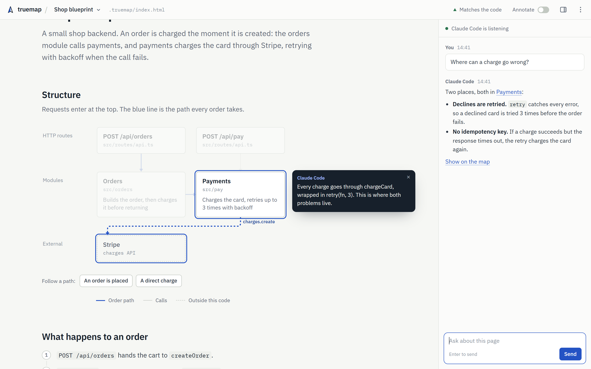

# truemap

**Review what your coding agents plan and what they changed, on a map of your system that stays true to the code.**

Your agent keeps a map of the project in your repo: small boxes in groups, each pinned to real code. Before a bigger change it draws the plan on that map and waits for your approval. After it edits, the changed boxes light up with their lines, one click away from the diff. You ask about anything right next to the map, and the answer points at the boxes it talks about.



## Why

Coding agents write code faster than anyone can read it. Review is the bottleneck, and a wall of text or a 40-file diff is the wrong place to do it.

- **Review the plan before the work.** For a change that touches several parts, the agent draws what it will add and touch on the map. Click a box to comment, then approve or ask for changes. The agent waits.
- **Review the change after the work.** Changed boxes carry their +/− lines; files no box covers are listed by folder. Click a box to see its diff. Measured from when the agent picked up your message, from when you approved the plan, or against your main branch.
- **Ask, and the answer points.** Answers come as short steps; each step lights up the boxes it is about. Escape or a click on empty space brings back the plain map.
- **Click any box.** What it does, what to know, why it is built that way, what it calls, and the real code (read live from your repo) when you want it.
- **A map that stays true.** Every box carries a `data-src="path#name"` anchor. When that code changes or disappears, the box is marked and the agent fixes the map.
- **Many projects.** Every project with truemap running is one click away, and the tab tells you when another one needs you (a plan to review, a new reply).
- **Any agent.** Claude Code, Codex, OpenCode, Cursor CLI, or agents inside hosts such as T3 Code: anything that can run a shell command.
- **It stays in the repo.** Maps live in `.truemap/`. Plain HTML files you commit, diff and share.

## Install

Install the skill once. That is the whole setup.

```sh
npx skills add TaoMachina/truemap --skill truemap
```

Then work with your agent as usual. Ask *"show me the project"* for a first map; ask for a bigger change and the agent shows the plan first. You can also ask directly: `/truemap draw the architecture`.

No skill installed? Tell the agent: *"use `npx -y truemap-cli --help`"*.

## How it works

```
your repo/
└── .truemap/
    ├── index.html        the map of the whole system
    ├── payments.html     a page per module, when one is needed
    └── plans/            plans the agent proposed (JSON)
```

| Command (run by the agent) | What it does |
|---|---|
| `npx -y truemap-cli [page]` | Opens the workspace in your browser, or switches the tab you already have open |
| `npx -y truemap-cli outline` | A compact outline of the repo, so the first map takes minutes |
| `npx -y truemap-cli plan --file plan.json` | Draws a plan on the map for review; `--approve` / `--done` from the terminal |
| `npx -y truemap-cli changes [--base head\|main]` | What changed, by box; opens the Changes view |
| `npx -y truemap-cli listen` | Waits for your next message, comments or approval |
| `npx -y truemap-cli reply "…" --listen` | Shows the answer in the panel, then keeps listening |
| `npx -y truemap-cli show [page] --focus ids --note "…"` | Points at the map while explaining |
| `npx -y truemap-cli check` | Checks every anchor against the code, and that each map follows the drawing rules |
| `npx -y truemap-cli export <page>` | Writes a page as one self-contained HTML file to share |
| `npx -y truemap-cli guide` | The guide for agents: maps, anchors, plans, changes |

The map is declared, not drawn: the agent writes groups, boxes and connections in HTML, and truemap lays them out (one reading direction, few crossings, curved arrows with a verb on each). The look is fixed on purpose, so every map reads the same.

Changes come from git. truemap snapshots the working tree through a throwaway copy of the index (your staging area is never touched) and attributes each changed file to the boxes whose anchors cover it.

Everything runs on your machine:

- The server listens on `127.0.0.1` only and needs a per-launch token.
- Pages render in a sandboxed frame on a separate origin, so page scripts can't reach the agent.
- Nothing leaves your machine. truemap keeps a local log of which commands ran (`~/.truemap/usage.jsonl`), the chat history and change snapshots per repo (`~/.truemap/`); delete them any time.

## Requirements

- Node.js 20 or newer
- git (for change review; without it, only missing paths and names are checked)

## License

MIT. Fonts: Instrument Sans and Commit Mono, SIL Open Font License (`kit/fonts/`).
